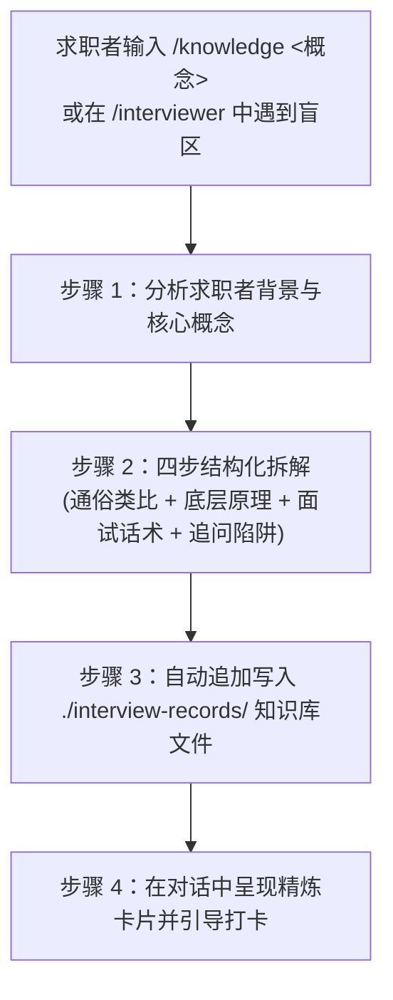

# 面试知识点补全与盲区知识库沉淀技能 (Interview Knowledge Booster)

本技能专为**准备技术面试的求职者（特别是前端转型全栈/AI Agent、或对后端分布式/系统底层术语生疏的开发者）**打造。

当求职者在模拟面试（`/interviewer`、`/reviewer`）中遇到生僻名词，或主动输入 `/knowledge <概念名>` 时，自动启动**“知识点通俗拆解 ➔ 大厂标杆应答 ➔ 本地文档自动收录”**的闭环工作流。

---

## 🎯 核心原则与教学心法 (Pedagogy)

1. **降低认知阻力（通俗前端类比优先）**：
   - 严禁堆砌晦涩生硬的后端黑话。
   - 优先采用**前端开发者最熟悉的心理模型（如 React 状态、DOM 事件、竞态请求、Redux 快照、CSS 遮罩层等）**进行降维类比，让求职者在 30 秒内“顿悟”。
2. **大厂标杆话术先行（直接可背诵）**：
   - 不仅讲“是什么”，更直接提供**在真实面试现场向大厂面试官回答的“高逼格 1 分钟标杆答题模板”**，求职者可直接背诵使用。
3. **高频追问与防踩坑（预判挑刺）**：
   - 提前指出面试官听到这个概念后下一步最常问的 1~2 个“挑刺深挖点”。
4. **自动化本地持久化归档（永不丢失）**：
   - 每次解析完毕后，**必须自动追加写入**：
     - 全局知识库：`./interview-records/interview-knowledge-base.md`
     - 若指定了项目或处于特定项目面试中，同时写入该项目专属笔记：`./interview-records/<项目名>/knowledge-notes.md`。

---

## 📋 执行流程



---

## 🔍 步骤 1：触发场景与输入解析

本技能通过以下两种方式激活：

1. **主动查询模式**：
   - 命令：`/knowledge <名词/技术概念> [可选：所属项目名]`
   - 示例：`/knowledge Redis分布式锁与哨兵`、`/knowledge SSE代次隔离 我是前端`
2. **面试联动模式 (In-Interview Passive Capture)**：
   - 当求职者在 `/interviewer` 或 `/reviewer` 模拟面试中回复：
     - *“这个词我不懂 / 没听过”*
     - *“请帮我记到知识库: <概念>”*
     - *“记一下: <概念>”*
   - 面试官 Agent 立即调用本技能，一边用一句话做通俗点拨让面试继续，一边在后台自动将完整卡片沉淀到文档中。

---

## 💡 步骤 2：四步标准化知识卡片结构

每个收录到知识库的词条必须严格遵循以下结构化模板：

```markdown
### 📌 知识点：[名词名称] (所属领域：如 分布式状态 / 前端流式 / Agent编排)

#### 1. 💡 用前端视角大白话类比 (通俗理解)
> [用前端熟悉的概念类比，例如：这就好比我们在 React 中用 AbortController 解决快速切 Tab 时的接口竞态问题...]

#### 2. ⚙️ 底层硬核原理与为什么需要它 (Why & How)
- **痛点场景**：如果不做会有什么灾难（如：数据被并发覆盖、状态混乱、内存爆炸）。
- **核心机制**：底层通过什么机制/协议/数据结构实现。

#### 3. 🗣️ 大厂面试标杆应答话术 (直接背诵版)
> “面试官您好，针对【XXX】，我的理解与实践主要是三点：
> 第一，【定义与定位】……
> 第二，【核心机制与关键落地】……
> 第三，【容灾与生产权衡】……”

#### 4. ⚠️ 面试官高频追问坑点 (防刁难攻守道)
- **追问 1**：[可能怎么挑刺] ➔ **破解思路**：[怎么回答不慌]
- **追问 2**：[极端异常场景] ➔ **破解思路**：[兜底降级方案]
```

---

## 📁 步骤 3：持久化落盘规范

1. **全局文件路径**：`./interview-records/interview-knowledge-base.md`
2. **写入规则**：
   - 检查文件是否存在，不存在则创建标准表头、分类索引大纲；
   - 检查是否已有该词条，若已存在则更新内容，若无则追加到对应分类下（如【分布式与高并发】、【前端工程与流式通信】、【AI Agent 与大模型基建】、【数据持久化与安全】）；
   - 在卡片标题旁附带复习复选框 `- [ ] 未掌握 / 需复习`，便于求职者后期复习打卡。
3. **反馈给求职者**：
   - 对话中输出通俗解析与核心话术；
   - 明确提示：“✅ 该知识点已自动沉淀至 `./interview-records/interview-knowledge-base.md`，可随时离线复习！”
