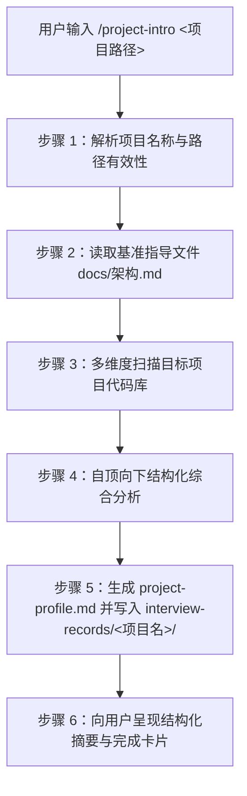

# 项目介绍与架构提炼生成器 (Project Intro Generator)

本技能依据全局架构分析指南 [`docs/架构.md`](../../../docs/架构.md)，对指定的目标项目进行“自顶向下”的深度工程解构与架构提炼，自动将分析成果落盘归档至 `./interview-records/<项目名>/project-profile.md`。

---

## 🎯 核心使命与落地目标

当用户输入 `/project-intro <项目路径>`（或 `/intro <项目路径>`）时：
1. **输入解析**：识别传入的本地项目路径（支持绝对路径或相对路径，自动提取标准项目名称 `<项目名>`）。
2. **六维自顶向下解构**：严格遵循 `docs/架构.md` 定义的 6 大维度：
   - 维度 1：业务背景与产品目标（解决什么问题、面向谁、核心名词/领域知识）
   - 维度 2：系统架构与设计决策（宏观骨架、模块交互、ADR决策、选型取舍）
   - 维度 3：数据模型与状态管理（表结构Schema、临时状态 vs 持久化事实策略）
   - 维度 4：代码目录结构与核心链路（分层规范、启动入口、核心骨干请求链路）
   - 维度 5：基础设施与部署运维（环境配置、容器化与编排、高可用容灾与无状态扩缩）
   - 维度 6：依赖管理与周边集成（包管理、外部API交互、幂等与重试设计）
3. **沉淀落盘与简历提炼**：
   - 自动生成符合 STAR 原则的简历描述范例（涵盖研发专家版、系统架构师版，以及 **1. AI应用工程师**、**2. 大模型应用开发工程师**、**3. AI Agent 研发工程师** 三个专项 AI 画像版本）；
   - 提炼面试考察的五大核心技术考点；
   - 自动写入目标归档文件：`./interview-records/<项目名>/project-profile.md`。

---

## 📋 执行流程与操作规范



### 步骤 1：解析项目路径与名称
1. 提取用户给出的 `<项目路径>`：
   - 例如：`D:\workspace\demo-service` -> 项目名称为 `demo-service`；
   - 例如：`projects/AgentRelay` -> 项目名称为 `AgentRelay`。
2. 验证项目路径存在性，若路径不存在则友好提示用户并指引正确路径。

### 步骤 2：对齐架构指导规约
- 读取工作区核心文件 [`docs/架构.md`](../../../docs/架构.md)，确保严格按照其要求提取 6 大模块，保证输出专业度与完整度。

### 步骤 3：项目工程深度扫描
在目标项目中自顶向下采集核心证据：
1. **包管理与核心依赖**（扫描 `package.json`、`pom.xml`、`requirements.txt`、`pyproject.toml`、`go.mod`、`Cargo.toml` 等）；
2. **工程目录与分层架构**（扫描根目录及 `src/` 一至二级结构，定位控制器 Controller、业务层 Service、持久层 DAO/Mapper/Repository、通信网关与模型契约）；
3. **数据模型与存储**（扫描 SQL DDL、Migration 脚本、Prisma/TypeORM/MyBatis/JPA 实体类、Redis/MQ 等中间件使用）；
4. **系统入口与核心请求链路**（定位 Application 启动类、路由注册、核心 Controller 或 API 接口入口）；
5. **部署配置与运维资产**（扫描 `Dockerfile`、`docker-compose.yml`、`k8s/`、`helm/`、`application.yml`、`.env.example` 等配置）；
6. **现有文档与设计记录**（扫描项目内部的 `README.md`、`docs/`、`ADR`、`架构.md` 等已有设计记录）。

### 步骤 4：生成标准的 project-profile.md
内容必须严格对齐并涵盖以下板块，结构规范清晰：

````markdown
# <项目名> 项目总览与架构画像提炼 (Project Profile)

> 归档时间：YYYY-MM-DD  
> 项目路径：`<绝对项目路径>`  
> 分析依据：工作流标准 `docs/架构.md` 六维解构体系

---

## 一、 业务背景与产品目标 (Why & Domain)
- **业务定位与核心价值**：系统面向谁、解决什么痛点、提供哪些核心能力。
- **核心功能与用户场景**：主要业务场景与用例。
- **领域概念与核心术语 (Domain Knowledge)**：梳理项目核心业务名词与专有名词定义。

---

## 二、 系统架构与设计决策 (Macro Architecture & ADR)
- **总体架构分层**：前端/接入层、业务编排层、领域服务层、数据存储层之间的拓扑与通信协议。
- **架构设计决策与技术取舍 (ADR)**：核心选型原因、为什么这么设计、计算与存储解耦、事实持久化与状态机设计权衡。
- **核心技术栈清单**：
  - 开发语言与主干框架
  - 核心中间件（缓存、消息队列、向量库、搜索引擎等）
  - 存储体系（关系型数据库、NoSQL、S3 等）
  - 外部系统与三方集成（模型 API、鉴权中心、支付等）

---

## 三、 数据模型与状态管理 (Data Model & State)
- **核心数据模型 (Schema / Entities)**：核心领域实体与表结构设计及其关联关系。
- **状态存储与持久化策略**：临时状态（如内存/Redis）与权威业务事实（MySQL/PostgreSQL）的清晰边界与落盘策略。
- **一致性与隔离机制**：事务设计、租户多级隔离模型、防并发穿透与防脏读设计。

---

## 四、 代码目录结构与核心链路 (Code Structure & Request Flow)
- **工程目录拓扑**：清晰展示源码核心目录及各层职责职责。
- **系统启动入口与配置加载**：入口文件路径、关键启动初始化逻辑。
- **核心骨干执行链路**：端到端梳理一个最典型、最核心的业务请求/事件处理生命周期（从请求到达、鉴权、业务编排、下游调用、持久化到结果响应）。

---

## 五、 基础设施与部署运维 (Infra & Operations)
- **环境配置体系**：多环境配置划分与敏感凭证管理。
- **容器化与集群编排**：Docker、Docker Compose、Kubernetes Pod/Deployment/Service 设计。
- **高可用与无状态运维策略**：无状态扩缩容支持、优雅停机、健康检查探针与容灾容错能力。

---

## 六、 依赖管理与周边集成 (Dependencies & Integration)
- **核心第三方依赖与工程治理**：核心依赖库用途与选型考量。
- **外部系统调用稳定性保障**：外部依赖熔断降级、超时控制、网络抖动重试机制与幂等性保障。

---

## 七、 简历项目经验提炼 (STAR 法则)

### 📌 范例 A：资深开发 / 全栈研发工程师版本 (强调工程实现、链路治理与性能)
- **项目名称**：...
- **担任角色**：...
- **项目背景 (Situation)**：...
- **核心任务 (Task)**：...
- **核心行动 (Action)**：包含 3~5 点具体、量化的深度技术攻坚动作。
- **产出结果 (Result)**：量化业务收益与系统稳定性指标。

### 🏛️ 范例 B：系统架构师 / 资深技术专家版本 (强调系统权衡、高可用容灾与领域建模)
- **项目名称**：...
- **担任角色**：...
- **架构背景 (Situation)**：...
- **关键架构决策与落地 (Action)**：系统解耦、高可用弹性容灾、领域契约标准等。
- **架构量化收益 (Result)**：高可用保证、性能提升与工程规范沉淀。

### 🤖 范例 C：AI 应用工程师版本 (强调 AI 业务落地、Prompt工程、评测与交付闭环)
- **项目名称**：...
- **担任角色**：AI 应用工程师
- **业务与模型背景 (Situation)**：...
- **核心落地目标 (Task)**：...
- **AI 攻坚与落地行动 (Action)**：侧重 RAG/文档知识摄取、Prompt/Few-shot 与上下文编排、模型输出结构化保障、多模态/版面分析模型接入适配等。
- **业务量化收益 (Result)**：文档解析召回率、幻觉率改善、端到端处理耗时与业务交付成效。

### 🧠 范例 D：大模型应用开发工程师版本 (强调 LLM 架构、RAG 向量检索管道、语义切片与推理治理)
- **项目名称**：...
- **担任角色**：大模型应用开发工程师 (LLM Application Developer)
- **工程背景 (Situation)**：...
- **核心工程目标 (Task)**：...
- **LLM 架构攻坚行动 (Action)**：侧重两阶段/多阶段检索增强 (RAG)、语义与层级切片 (Chunking)、快照/版本一致性控制、LLM 调用链防超时与降级策略、结构化输出保障等。
- **系统指标收益 (Result)**：RAG 准确率、检索吞吐量、Token 成本压降与端到端延迟表现。

### 🦾 范例 E：AI Agent 研发工程师版本 (强调 Agent 编排、工具调用契约、状态机与安全沙箱)
- **项目名称**：...
- **担任角色**：AI Agent 研发工程师
- **自主智能背景 (Situation)**：...
- **核心 Agent 架构目标 (Task)**：...
- **Agent 机制实现行动 (Action)**：侧重 Plan-and-Solve / ReAct 范式、外部 Tool Calling / Action 契约定义、单向受限执行沙箱、HMAC/白名单安全治理、状态机与执行 Journal 幂等回溯等。
- **Agent 指标收益 (Result)**：指令执行成功率、工具调用准确率、多步规划稳定性与安全零越权。

---

## 八、 规划的五大核心面试考察考点
1. **架构与选型**：...
2. **核心业务实现**：...
3. **并发与性能**：...
4. **异常与边界容灾**：...
5. **工程与排障**：...
````

### 步骤 5：自动写入归档文件
- 检查目标目录 `./interview-records/<项目名>/`，若不存在则自动创建；
- 写入文件 `./interview-records/<项目名>/project-profile.md`；
- 确保写入成功且内容完整无残缺。

### 步骤 6：反馈用户
向用户汇报生成完毕，提供文件位置（`./interview-records/<项目名>/project-profile.md`），并附带关键架构速览，方便用户随时复习或作为后续 `/interviewer` 模拟面试的参考输入。
