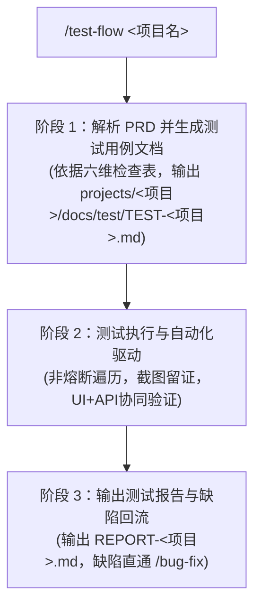

# 自动化测试工作流 (test-auto-workflow)

本技能实现了与 `test-auto-workflow` 深度集成的端到端自动化测试流水线。支持通过斜杠命令 `/test-flow <项目名>` 显式启动，或在开发工作流完成时经用户确认后无缝接入。

---

## 1. 触发与命令语法

```bash
/test-flow <项目名称或PRD路径>
```

**示例**：
- `/test-flow AgentRelay`
- `/test-flow projects/AI-StoryBoard-Studio/docs/prd/PRD-AI-StoryBoard-Studio.md`

---

## 2. 核心执行闭环 (三阶段推进)



---

## 3. 详细阶段动作

### 阶段 1：解析 PRD 并生成测试用例文档 (Test Case Generation)
1. **定位 PRD**：检索 `projects/<项目名称>/docs/prd/` 目录下的 PRD 文档。若指定具体文件路径则直接读取。
2. **多维需求提取**：
   - **输入项与校验规则**：必填/选填、长度范围、字符集限制、跨字段校验；
   - **核心交互流程**：主业务路径、取消/返回路径、分支跳转；
   - **权限与隔离规则**：多角色可见性、越权控制、多租户数据隔离；
   - **状态机流转**：实体生命周期状态迁移与逆向边界；
   - **API 接口列表**：请求路径、入参、响应字段结构与业务状态码。
3. **对照六维检查表扩展设计**：
   - 严格对照 `workflows/test/references/case-design-checklist.md`，补全字段级、操作级、权限级、状态级、异常级、数据级的测试点。
4. **生成测试用例文档**：
   - 输出至 `projects/<项目名称>/docs/test/TEST-<项目名称>.md`，严格遵循 `workflows/test/templates/test-cases-template.md` 规范。
5. **可选生成自动化测试脚本**：
   - 可调用 `../test-auto-workflow/yaml_generator.py` 为前端/Web 需求生成 YAML 测试脚本至 `projects/<项目名称>/tests/e2e/`。

### 阶段 2：执行测试验证 (Test Execution)
1. **准备被测环境**：
   - 确认项目服务已启动或目标测试 URL 可访问（或使用项目已编写的测试套件/集成测试服务）。
2. **测试驱动执行**：
   - **模式 1 (Playwright/Runner 执行)**：若已生成 YAML 测试脚本，执行：
     ```powershell
     python ../test-auto-workflow/script_runner.py <脚本路径> --url <服务地址> --api-base <API地址> --project <项目名称>
     ```
   - **模式 2 (用例对照执行)**：按照 `TEST-<项目名称>.md` 的用例步骤逐条测试验证（可配合工具/端到端命令/接口请求执行）。
3. **执行纪律**：
   - **非熔断设计**：单条用例执行失败不中断后续用例，捕获异常后继续测试下一条；
   - **失败截图留证**：界面或流程失败时截取当前屏幕，存入 `projects/<项目名称>/docs/test/screenshots/`；
   - **网络一致性校验**：比对 UI 显示数据与底层网络接口返回的 JSON 数据是否一致。

### 阶段 3：测试报告与缺陷闭环 (Reporting & Defect Loop)
1. **生成测试执行报告**：
   - 输出至 `projects/<项目名称>/docs/test/REPORT-<项目名称>.md`。
   - 统计用例总数、通过数、失败数、跳过数及通过率。
2. **沉淀缺陷清单**：
   - 若测试中发现失败项，逐一梳理为包含复现步骤、实际结果、预期结果与留证截图的缺陷条目。
3. **联动缺陷修复工作流**：
   - 提示用户可直接使用 `/bug-fix <缺陷编号或描述>` 启动修复流程，实现“测试发现缺陷 ➔ Bug-Fix 修复 ➔ 回归测试”的工程闭环。
