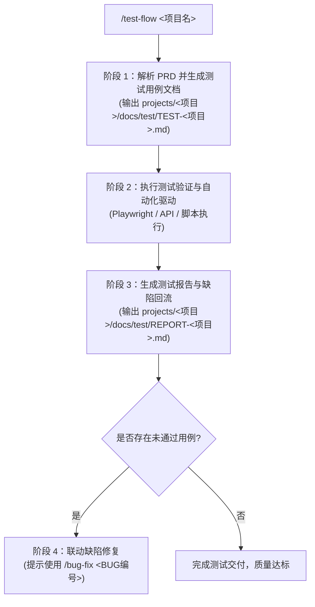

# /test-flow: 依据 PRD 自动生成测试用例并执行测试工作流

从工作区指定项目的 PRD 文档出发，结合六维测试用例设计检查表，自动提取并设计生成结构化测试用例文档，并驱动执行端到端/自动化测试，最终产出测试报告与缺陷清单。

**语法**：
`/test-flow <项目名称或PRD路径>`

**示例**：
- `/test-flow AgentRelay`
- `/test-flow projects/AgentRelay/docs/prd/PRD-AgentRelay-远程AI任务伴侣.md`

---

## 执行编排流水线

---

## 阶段具体动作与产出

### 阶段 1：解析 PRD 生成测试用例文档
1. **文档检索**：定位目标项目的需求文档 `projects/<项目名称>/docs/prd/*.md`。
2. **需求提炼**：提取核心业务流程、输入字段与校验规则、权限边界、状态迁移路径及 API 端点。
3. **六维扩展设计**：严格依照 `workflows/test/references/case-design-checklist.md`，扩展设计字段级、操作级、权限级、状态级、异常级、数据级用例。
4. **用例文档落盘**：将测试用例文档写入 `projects/<项目名称>/docs/test/TEST-<项目名称>.md`。
5. **脚本可选生成**：对适合批量自动化执行的场景，可调用 `../test-auto-workflow/yaml_generator.py` 生成 YAML 测试脚本存入 `projects/<项目名称>/tests/e2e/`。

### 阶段 2：依据测试用例文档执行测试
1. **环境准备与探查**：确认被测服务可用性（端口、本地服务或线上地址）。
2. **自动化测试执行**：
   - 方式 A：调用 `../test-auto-workflow/script_runner.py` 驱动 Playwright 执行 YAML 测试脚本。
   - 方式 B：对照 `TEST-<项目名称>.md` 逐条进行端到端/接口调用验证。
3. **执行纪律**：
   - **非熔断设计**：单条用例失败不中断后续用例，捕获异常后继续测试下一条；
   - **失败截图留证**：界面或流程失败时截取当前屏幕，存入 `projects/<项目名称>/docs/test/screenshots/`；
   - **UI 与 API 一致性核对**：核验界面展示数据与网络请求响应一致性。

### 阶段 3：生成测试报告与沉淀缺陷清单
1. 统计测试结果（通过 / 失败 / 阻塞），输出测试报告至 `projects/<项目名称>/docs/test/REPORT-<项目名称>.md`。
2. 梳理缺陷清单（含严重级、复现步骤、实际结果与截图）。

### 阶段 4：缺陷修复联动
若存在未通过用例，提示用户可一键通过缺陷修复工作流处理：
> 💡 提示：输入 `/bug-fix <缺陷编号或描述>` 即可启动 TDD 缺陷闭环修复流程。
