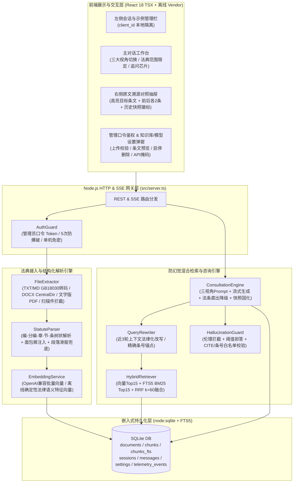
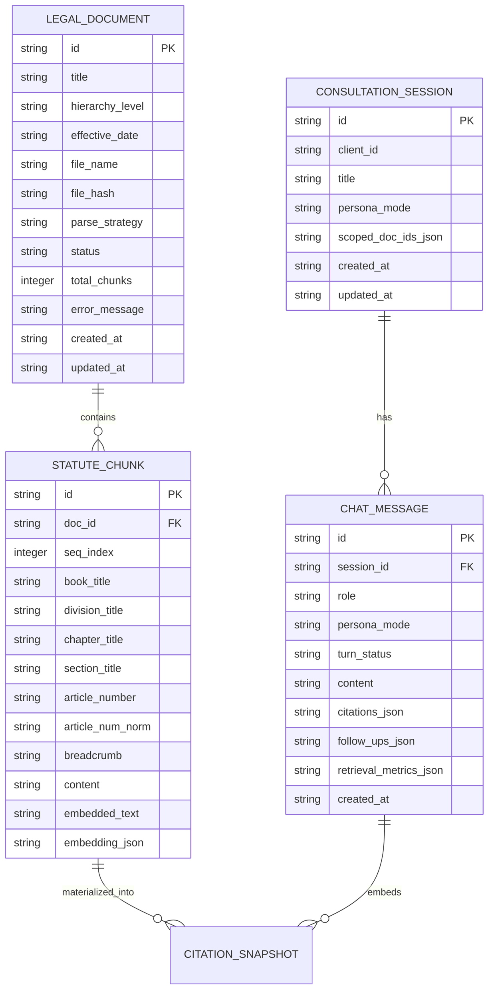

# 【技术方案设计】LexRAG - 法律法规条文级溯源与智能咨询系统 (TRD)

| 文档版本 | 文档状态 | 编写人 | 评审日期 | 关联 PRD | 架构模式 |
| :--- | :--- | :--- | :--- | :--- | :--- |
| **V1.0.0** | Approved | 架构师 / 全栈研发 | 2026-11-25 | [PRD-LexRAG.md](../prd/PRD-LexRAG.md) | **双引擎防幻觉混合 RAG + React TSX 双栏溯源工作台** |

---

## 1. 架构总览与设计目标

### 1.1 系统上下文与设计目标
LexRAG 面向个人日常维权（大众普法）、企业用工合规（企业合规）与法律专业研判（专业法研）三大场景，解决“口语化案情与严谨法言法语之间的语义鸿沟”和“通用大模型法条幻觉高危风险”两大核心问题。

- **全局强制规约（严格遵循 GEMINI.md）**：
  1. **全栈 TypeScript (`.ts` / `.tsx`)**：后端 HTTP/SSE 服务、文档解析器、混合检索引擎、SQLite 存储、鉴权模块及单元测试全部采用可擦除类型语法（Erasable TypeScript）编写，适配 Node v24 原生 TS 运行时，并通过严格 `tsc --noEmit` 类型检查。
  2. **现代前端框架选型**：采用 **React 18 + TypeScript (`.tsx`) + 本地离线 Vendor (React / ReactDOM / Babel Standalone)** 实现组件化、状态驱动的双栏溯源工作台，严禁使用纯原生 HTML + 原生 JS 操控 DOM。
  3. **内网/离线零外部中间件依赖**：数据存储与索引完全基于 Node 内置 `node:sqlite`（启用 `FTS5` 全文倒排索引）与本地向量存储；不强依赖外部向量数据库集群或公网 CDN。
  4. **零幻觉双门控 + 法条直出降级**：通过前置伦理拦截、检索阈值硬拒答、后置条号白名单校验保证引用零虚构；当外部 LLM 或 Embedding 异常/未配置时，无缝降级为本地“法条直出降级模式”与确定性语义特征哈希向量 + FTS5 BM25 检索，确保核心查法服务 100% 不中断。

### 1.2 架构全景图 (Architecture Overview)



---

## 2. 领域模型与数据架构 (Data Schema)

### 2.1 实体关系图 (ER Diagram)



### 2.2 SQLite 表结构定义 (DDL)

系统初始化时自动创建以下 7 张核心表与索引（开启 `WAL` 模式与外键约束）：

1. **`documents`**：法典元数据与生命周期主表
   - 字段：`id TEXT PRIMARY KEY`, `title TEXT NOT NULL`, `hierarchy_level TEXT NOT NULL`, `effective_date TEXT NOT NULL`, `file_name TEXT NOT NULL`, `file_ext TEXT NOT NULL`, `file_size INTEGER NOT NULL`, `file_hash TEXT NOT NULL`, `stored_path TEXT NOT NULL`, `parse_strategy TEXT NOT NULL DEFAULT 'statutory_tree'`, `status TEXT NOT NULL`, `total_chunks INTEGER NOT NULL DEFAULT 0`, `error_message TEXT`, `created_at TEXT NOT NULL`, `updated_at TEXT NOT NULL`。
   - 部分唯一索引：`CREATE UNIQUE INDEX idx_documents_active_hash ON documents(file_hash) WHERE status != 'deleted'`（防止重复内容重复上传，同时允许删除后重传）。
2. **`chunks`**：法典条文切片与向量持久化表
   - 字段：`id TEXT PRIMARY KEY`, `doc_id TEXT NOT NULL`, `seq_index INTEGER NOT NULL`, `book_title TEXT NOT NULL DEFAULT ''`, `division_title TEXT NOT NULL DEFAULT ''`, `chapter_title TEXT NOT NULL DEFAULT ''`, `section_title TEXT NOT NULL DEFAULT ''`, `article_number TEXT NOT NULL DEFAULT ''`, `article_num_norm TEXT NOT NULL DEFAULT ''`, `breadcrumb TEXT NOT NULL`, `content TEXT NOT NULL`, `embedded_text TEXT NOT NULL`, `embedding_json TEXT NOT NULL`, `FOREIGN KEY(doc_id) REFERENCES documents(id) ON DELETE CASCADE`。
   - 索引：`CREATE INDEX idx_chunks_doc_seq ON chunks(doc_id, seq_index)`、`CREATE INDEX idx_chunks_art_norm ON chunks(article_num_norm)`。
3. **`chunks_fts`**：FTS5 倒排全文索引虚表
   - DDL：`CREATE VIRTUAL TABLE chunks_fts USING fts5(chunk_id UNINDEXED, doc_id UNINDEXED, tokens)`。
   - 中文分词策略：存储经 `tokenizeForFts()` 预处理的空间分隔 Token（含中文二元切分 Bigram、连续词、英文/数字 Token、中文与阿拉伯数字双向归一化条号）。
4. **`sessions`**：用户多轮咨询会话表
   - 字段：`id TEXT PRIMARY KEY`, `client_id TEXT NOT NULL`, `title TEXT NOT NULL`, `persona_mode TEXT NOT NULL DEFAULT 'public'`, `scoped_doc_ids_json TEXT NOT NULL DEFAULT '[]'`, `created_at TEXT NOT NULL`, `updated_at TEXT NOT NULL`。
   - 索引：`CREATE INDEX idx_sessions_client ON sessions(client_id, updated_at DESC)`。
5. **`messages`**：咨询对话消息及引用快照持久化表
   - 字段：`id TEXT PRIMARY KEY`, `session_id TEXT NOT NULL`, `role TEXT NOT NULL`, `persona_mode TEXT NOT NULL`, `turn_status TEXT NOT NULL`, `content TEXT NOT NULL`, `citations_json TEXT NOT NULL DEFAULT '[]'`, `follow_ups_json TEXT NOT NULL DEFAULT '[]'`, `retrieval_metrics_json TEXT`, `created_at TEXT NOT NULL`, `FOREIGN KEY(session_id) REFERENCES sessions(id) ON DELETE CASCADE`。
   - 注：`citations_json` 完整落盘 `CitationSnapshot[]`（含目标条文原文、法典名、效力层级、施行日期、结构面包屑及前后各 2 条邻近条文），确保源文档停用或删除后历史消息溯源永不失效。
6. **`settings`**：系统配置键值表
   - 字段：`key TEXT PRIMARY KEY`, `value_json TEXT NOT NULL`, `updated_at TEXT NOT NULL`（存储 `model_settings` 与向量维度绑定元信息）。
7. **`telemetry_events`**：本地可观测性与北极星指标审计表
   - 字段：`id TEXT PRIMARY KEY`, `event_id TEXT NOT NULL`, `payload_json TEXT NOT NULL`, `created_at TEXT NOT NULL`。

---

## 3. 核心接口与协议规范 (API Contracts & TS Signatures)

### 3.1 REST / SSE 接口清单

| 接口名称 | 方法与路径 | 描述 | 鉴权要求 |
| :--- | :--- | :--- | :--- |
| 健康检查 | `GET /api/v1/health` | 返回服务状态、数据库统计、鉴权模式与降级状态 | 公开 |
| 管理员解锁 | `POST /api/v1/auth/login` | 校验 `ADMIN_PASSCODE`，连续 5 次错误冷却 60 秒 | 公开（限频防爆破） |
| 鉴权状态查询 | `GET /api/v1/auth/status` | 查询当前是否单机免密模式及管理员 Token 是否有效 | 公开 |
| 获取已启用法典清单 | `GET /api/v1/documents/public` | 供聊天范围多选框读取 `active` 状态法典基础信息 | 公开 |
| 管理员获取全部法典 | `GET /api/v1/admin/documents` | 获取含 `pending/indexing/active/disabled/failed` 全部法典 | 管理员 |
| 上传并解析法典 | `POST /api/v1/admin/documents/upload` | 接收文件名、Base64/文本内容及元数据，执行去重/重名检测与入库 | 管理员 |
| 导入内置示范法典 | `POST /api/v1/admin/documents/seed` | 一键导入内置《民法典（核心编章）》与《劳动合同法》 | 管理员 |
| 预览法典切分条文 | `GET /api/v1/admin/documents/:id/chunks` | 返回指定法典切分后的条文列表（支持关键字/条号过滤） | 管理员 |
| 启停法典状态 | `PATCH /api/v1/admin/documents/:id/status` | 实时切换 `active` <-> `disabled`（免重算向量） | 管理员 |
| 重试失败解析任务 | `POST /api/v1/admin/documents/:id/retry` | 重新解析与向量化处于 `failed` 状态的文档 | 管理员 |
| 删除法典文档 | `DELETE /api/v1/admin/documents/:id` | 物理删除文档及索引切片（历史会话快照保留） | 管理员 |
| 读取/保存模型配置 | `GET/PUT /api/v1/admin/settings` | 读取（API Key 掩码脱敏）与更新 LLM / Embedding 配置 | 管理员 |
| 测试模型连通性 | `POST /api/v1/admin/settings/test` | 分别探测 Chat LLM 与 Embedding 接口可用性与向量维度 | 管理员 |
| 全量重建向量索引 | `POST /api/v1/admin/documents/reindex` | 切换 Embedding 模型维度后重建全部未删除文档向量 | 管理员 |
| 会话列表/新建/修改/删除 | `GET/POST/PATCH/DELETE /api/v1/sessions` | 基于请求头 `x-client-id` 强隔离会话增删改查 | `x-client-id` |
| 发起咨询问答 (JSON/SSE) | `POST /api/v1/chat` | 执行防幻觉检索与咨询生成（支持 SSE 流式与 JSON 返回） | `x-client-id` |
| 查询引用条文上下文 | `GET /api/v1/citations/:messageId/:chunkId` | 优先查询实时库，源文档停用/删除时无缝降级返回历史快照 | `x-client-id` |
| 查看埋点监控汇总 | `GET /api/v1/admin/telemetry` | 汇总上传成功率、防幻觉拦截数与降级触发次数 | 管理员 |

### 3.2 核心 TypeScript 接口签名契约 (`src/types/index.ts`)

```typescript
export type HierarchyLevel =
  | '宪法'
  | '法律'
  | '行政法规'
  | '司法解释'
  | '部门规章'
  | '地方性法规'
  | '企业规章制度'
  | '其他规范性文件';

export type DocumentStatus =
  | 'pending'
  | 'indexing'
  | 'active'
  | 'disabled'
  | 'failed'
  | 'deleted';

export type ParseStrategy = 'statutory_tree' | 'sliding_window';
export type PersonaMode = 'public' | 'compliance' | 'professional';
export type TurnStatus =
  | 'completed'
  | 'refused_ethics'
  | 'refused_unmatched'
  | 'degraded_direct'
  | 'aborted';

export type LexRagErrorCode =
  | 'INVALID_INPUT'
  | 'EMPTY_FILE'
  | 'FILE_TOO_LARGE'
  | 'UNSUPPORTED_FORMAT'
  | 'MAGIC_MISMATCH'
  | 'ENCRYPTED_PDF'
  | 'SCANNED_PDF_REJECTED'
  | 'DUPLICATE_HASH'
  | 'TITLE_CONFLICT'
  | 'UNAUTHORIZED'
  | 'FORBIDDEN'
  | 'TOO_MANY_ATTEMPTS'
  | 'NOT_FOUND'
  | 'STATE_CONFLICT'
  | 'LLM_UNAVAILABLE'
  | 'EMBEDDING_UNAVAILABLE';

export class LexRagError extends Error {
  public readonly code: LexRagErrorCode;
  public readonly statusCode: number;
  public readonly details?: unknown;
}

export interface LegalDocument {
  id: string;
  title: string;
  hierarchyLevel: HierarchyLevel;
  effectiveDate: string;
  fileName: string;
  fileExt: string;
  fileSize: number;
  fileHash: string;
  storedPath: string;
  parseStrategy: ParseStrategy;
  status: DocumentStatus;
  totalChunks: number;
  errorMessage?: string;
  createdAt: string;
  updatedAt: string;
}

export interface StatuteChunk {
  id: string;
  docId: string;
  seqIndex: number;
  bookTitle: string;
  divisionTitle: string;
  chapterTitle: string;
  sectionTitle: string;
  articleNumber: string;
  articleNumNorm: string;
  breadcrumb: string;
  content: string;
  embeddedText: string;
  embedding: number[];
}

export interface NeighborArticle {
  chunkId: string;
  seqIndex: number;
  articleNumber: string;
  breadcrumb: string;
  content: string;
  isTarget: boolean;
}

export interface CitationSnapshot {
  chunkId: string;
  docId: string;
  docTitle: string;
  hierarchyLevel: HierarchyLevel;
  effectiveDate: string;
  articleNumber: string;
  articleNumNorm: string;
  breadcrumb: string;
  content: string;
  neighbors: NeighborArticle[];
  score: number;
  sourceStatus?: 'active' | 'disabled' | 'deleted';
}

export interface LlmAdapter {
  complete(params: {
    systemPrompt: string;
    messages: Array<{ role: 'user' | 'assistant'; content: string }>;
    temperature?: number;
    timeoutMs?: number;
    signal?: AbortSignal;
    onToken?: (token: string) => void;
  }): Promise<string>;
}

export interface EmbeddingAdapter {
  embedBatch(texts: string[]): Promise<number[][]>;
  getDimension(): number;
  isExternal(): boolean;
}
```

---

## 4. 关键技术方案与算法逻辑

### 4.1 法典结构感知切分与中文数字条号归一化 (`src/engines/statuteParser.ts`) & PDF 多字体提取 (`src/engines/fileExtractor.ts`)
1. **PDF 多字体 `Type0`/`Identity-H` 精准抽取**：按 PDF 对象图解析每个 `/Page` 关联的 `/Resources -> /Font` 及其独立的 `/ToUnicode` CMap（同时兼容 `beginbfchar` 与 `beginbfrange`），支持 `TJ`/`Tj` 字面量双字节 CID 解码与 `Tm`/`Td`/`TD` 坐标换行还原，彻底避免多字体 CID 冲突及整页换行丢失。
2. **目录去噪与页眉/免责声明清洗**：过滤形如 `^第[一二三四五六七八九十百千万0-9]+[编章节].*[…\.·]{2,}\s*\d+$` 的目录行、文末 `*** 本信息仅供参考... ***` 免责声明及连续重复短页眉行；清理 PDF 字距导致的中文标点多余空格，并在断行处根据中文句末标点自动合并硬换行同时保留多款段落。
3. **五级层级状态机 (`编 -> 分编 -> 章 -> 节 -> 条` + `附则`)**：
   - 当识别到新 `第X编` 或独立 `附则` 时，自动清空下级 `divisionTitle`、`chapterTitle`、`sectionTitle`；
   - 识别到新 `第X章` 时，清空 `sectionTitle`；
   - 识别到新 `第X条` 时，归并此前缓存的上条正文，生成纯净条文 `content`，并通过 `chineseToArabic` / `arabicToChinese` 生成双向归一化字段（例如 `第五百七十七条` ⇄ `第577条`）。
4. **超长条按款拆分**：若单条字符数 > 1500 字，按换行段落拆分为多个 `StatuteChunk`，所有子切片保持相同的 `articleNumber` 与 `articleNumNorm`，仅 `seqIndex` 递增，确保检索命中后上下文完整。
5. **面包屑前缀注入与非标兜底**：生成 `embeddedText = "【" + docTitle + " | " + hierarchyLevel + " | " + breadcrumb + "】\n" + content`；当全文识别出的标准 `第X条` 数量 `< 3` 时，自动切换为 `sliding_window` 策略（窗口大小 `600` 字、重叠 `100` 字）。

### 4.2 口语案情法律化改写与 RRF 混合检索 (`src/engines/queryRewriter.ts` + `hybridRetriever.ts`)
1. **近 3 轮上下文 Query 改写**：
   - 优先调用 LLM 将最近 3 轮对话与当前口语提问改写为“口语原义 + 规范法律检索词”（超时上限 3 秒）；
   - 当 LLM 未配置或改写超时时，自动启用内置**高频口语-法言同义词典扩展器**（如 `赶我走/收房 -> 租赁合同 提前解除 违约`、`不给赔偿/辞退 -> 解除劳动合同 经济补偿 赔偿金`、`押金不退 -> 租赁 押金 返还`），同时抽取用户输入中的精确条号锚点（如 `577条` -> `第577条 第五百七十七条`）。
2. **双路混合召回 + RRF (`k = 60`) 融合重排**：
   - **路一（向量语义检索）**：过滤 `status = 'active'` 且属于当前 `scopedDocIds` 的切片，计算查询向量与 `embedding` 的余弦相似度，取 Top-15；
   - **路二（SQLite FTS5 BM25 检索）**：通过 `tokenizeForFts()` 将 Query 转为 CJK Bigram + 归一化条号检索式，调用 SQLite `bm25(chunks_fts)` 取 Top-15；
   - **精确条号强加权与 RRF 融合**：`RRF(chunk) = 1/(60 + rank_vec) + 1/(60 + rank_fts) + exactArticleBoost`，输出 Top-8 权威条文池。

### 4.3 三重防幻觉门控与历史快照固化 (`src/engines/hallucinationGuard.ts` + `consultationEngine.ts`)
1. **第一重（前置伦理与违法教唆拦截）**：精确识别“教唆犯罪、伪造合同/考勤/病假条、隐匿财产逃避执行”等违法意图直接返回 `refused_ethics`；同时通过上下文主语识别，放行“对方伪造证据/老板逼我签阴阳合同怎么维权”等合法维权提问。
2. **第二重（检索低相关性硬拒答）**：若 `active` 范围切片为空，或最高向量相似度 `< 0.32` 且无有效关键词/精确条号命中（`topBm25Hits === 0` 或综合相关性未达门槛），强制返回 `refused_unmatched`，禁止调用 LLM 自由作答。
3. **第三重（生成后置白名单校验 + 快照固化）**：
   - 强制要求模型在回复中使用 `[CITE:chunkId]` 引用召回池条文；
   - 后端校验器扫描输出中的所有 `[CITE:xxx]` 与文本出现的 `第[一二三四五六七八九十百千万0-9]+条`：凡不在本轮召回白名单中的引用标记与越界条号一律拦截/剥离，并记录 `hallucination_guard_intercept` 审计事件；若模型未留下任何合法引用但文本尝试引用虚构法条，自动回退展示本轮真实召回条文卡片。
   - 落盘时立即将命中条文及其 `[seqIndex - 2, seqIndex + 2]` 邻近条文序列化为 `CitationSnapshot[]` 写入消息记录。

---

## 5. 异常处理与容灾降级 (Fault Tolerance)

| 故障或边界场景 | 检测方式 | 系统处理与降级策略 |
| :--- | :--- | :--- |
| **扫描版无文本层 PDF 误传** | 提取页数 > 0 且平均每页有效文字 `< 15` 字符 | 秒级拦截并返回 `422 SCANNED_PDF_REJECTED` 引导转换为文字版 |
| **加密 PDF / 假后缀 / 空文件** | 魔数校验、`/Encrypt` 标记、字节长度为 0 | 秒级拦截返回明确 `LexRagError`，不写入脏数据库记录 |
| **Embedding API 批量限流/超时** | HTTP 429 / 5xx / 网络超时 | 批次 20 条 + 最多 3 次指数退避重试；未恢复则标记 `failed` 并支持一键重试；无外部 Key 时自动使用离线 256 维确定性语义特征向量 |
| **Chat LLM 超时、429 或断网** | 请求超时 / 网络异常 / 未配置 API Key | **自动切换为“法条直出降级模式 (`degraded_direct`)”**，保留混合检索命中的 Top-5 权威原文卡片与右侧上下文核验抽屉 |
| **源法典被管理员停用或删除** | 查询 `documents.status` 为 `disabled` 或记录缺失 | 历史消息自动回退读取 `messages.citations_json` 内固化的 `CitationSnapshot`，在右侧抽屉显示“源法典当前已停用/已移除（历史快照）”徽标 |
| **管理员口令暴力破解** | 同一 IP/来源连续 5 次口令校验失败 | 锁定 60 秒并返回 `429 TOO_MANY_ATTEMPTS` |

---

## 6. 部署架构与依赖环境

- **运行时**：Node.js v22.6+ / v24+（直接使用内置 `node:http`、`node:sqlite`、`node:zlib`、`node:crypto`、`node:test`，零第三方运行时强依赖）。
- **类型校验与测试**：
  - 启动服务：`node projects/LexRAG/src/server.ts --port 3100`
  - 运行测试：`node --test projects/LexRAG/tests/*.test.ts`
  - 静态类型检查：`tsc -p projects/LexRAG/tsconfig.json --noEmit`
- **关键环境变量**：
  - `PORT`：Web 服务端口（默认 `3100`）
  - `LEXRAG_DATA_DIR`：SQLite 数据库与上传文件存储目录（默认 `projects/LexRAG/data`）
  - `ADMIN_PASSCODE`：管理员解锁口令（默认 `lexrag-admin`，生产部署建议显式指定）
  - `SINGLE_USER_MODE`：设为 `true` 时开启单机免密模式（默认 `false`）
  - `LLM_BASE_URL` / `LLM_API_KEY` / `LLM_MODEL`、`EMBEDDING_BASE_URL` / `EMBEDDING_API_KEY` / `EMBEDDING_MODEL`：可选初始化 OpenAI 兼容模型配置。
