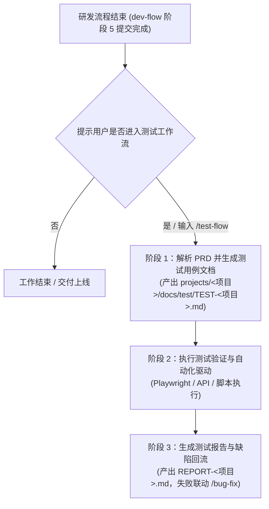

# 测试工作流 (workflows/test)

测试工作流是本工作区软件工程闭环（产品 ➔ 开发 ➔ 测试 ➔ 缺陷修复）的关键组成部分。它与 `test-auto-workflow` 深度结合，面向 QA、测试工程师及全栈开发者，提供由需求驱动的端到端自动化测试支撑。

---

## 核心工作流闭环



---

## 目录结构

- `references/`
  - `case-design-checklist.md`：六维测试用例设计检查表（字段/操作/权限/状态/异常/数据）。
  - `test-execution-guide.md`：自动化测试执行指南与驱动策略。
- `templates/`
  - `test-cases-template.md`：测试用例文档标准模板（`TEST-<项目名>.md`）。
  - `test-report-template.md`：测试报告标准模板（`REPORT-<项目名>.md`）。

---

## 快速调用

用户在开发完成后，可通过斜杠命令直接启动测试工作流：

```bash
/test-flow <项目名称或PRD路径>
```

示例：
- `/test-flow AgentRelay`
- `/test-flow projects/LexRAG/docs/prd/PRD-LexRAG.md`
